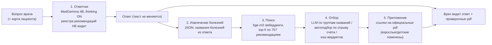

# med_assistant — локальный LLM-ассистент врача по клиническим рекомендациям

Полностью автономный медицинский справочный ассистент для врача: отвечает на
клинические вопросы по-русски и к каждому ответу **подбирает проверочные
ссылки на официальные клинические рекомендации Минздрава** (757 документов).
Работает целиком на обычном ноутбуке — без интернета, облака и установки
какого-либо ПО: целевая машина получает один zip-архив, дальше `Start.bat`.

Для кого: врачи широкой практики, фельдшеры, молодые специалисты — ситуации
«пришёл к пациенту, детали не помню, спросить не у кого, связи нет».

Почему локально, а не облачная LLM:

- **Приватность.** Вопросы и амбулаторные карты пациентов — персональные
  медицинские данные (152-ФЗ): они не должны покидать устройство. Стек не
  имеет внешних зависимостей вообще — «уходить» нечему.
- **Автономность.** Выезд, село, дежурство, «слепые зоны» связи — ассистент
  работает без сети. Медленнее облака (десятки секунд на ответ на CPU) — это
  осознанная цена автономности.
- **Достоверность ссылок.** Модель-ответчик физически не видит реестр
  рекомендаций — «придумать» ссылку она не может (см. «Ключевой принцип»
  ниже). Ссылки подбирает отдельный конвейер и только на реально существующие
  официальные pdf.

> ⚠️ Это справочный инструмент для врача, а не система принятия решений:
> финальный контроль всегда за человеком.

## Демонстрация

- Скринкаст (3–5 мин): [видео в GitHub Releases](https://github.com/isemsez/med_assistant/releases).
- Веб-интерфейс после запуска: `http://127.0.0.1:8866`, страница наблюдаемости
  `http://127.0.0.1:8866/admin`.

## Архитектура

Answer-first конвейер: ответ модели никогда не редактируется, ссылки на
рекомендации — отдельный проверяемый блок («приложение») под ответом.



Три процесса инференса (llama.cpp `llama-server`, OpenAI-совместимый API) и
веб-приложение:

| Процесс | Порт | Модель | Роль |
|---|---|---|---|
| answerer | 8081 | MedGemma 1.5 4B Q4_K_M (text-only), num_ctx 12288, thinking ON, temp 0 | ответ на вопрос |
| labeler | 8082 | тот же GGUF, think-подавляющий chat-шаблон | извлечение болезней, отбор pdf |
| embed | 8083 | bge-m3 F16 | эмбеддинги для поиска |
| web | 8866 | — | FastAPI + SSE чат, статика, API |

Ответчик и лейблер — два процесса с одной моделью не для GPU/CPU-разделения,
а потому что chat-шаблон в llama.cpp задаётся на процесс (нужны разные
хвосты промпта: открытый `think` у ответчика и заранее закрытый у лейблера),
а фоновое приложение-подбор предыдущего вопроса не блокирует стрим следующего
ответа. На CPU оба процесса mmap'ят один GGUF — второй стоит ≈ KV-кэша.

## Ключевой принцип: ссылку нельзя придумать

Наивный RAG просит LLM «ответить по документам» — и модель галлюцинирует
источники. Здесь ответственность разделена архитектурно:

- ответчик **не знает о существовании реестра рекомендаций** — в его промпт
  не попадает ни один документ, он не может сослаться;
- ответ **никогда не правится** и не дополняется — ссылочный блок формируется
  отдельным конвейером и визуально отделён;
- в приложение попадают только реально существующие локальные pdf (битых
  ссылок нет: нет файла — нет строки);
- отфильтрованные кандидаты остаются видимыми врачу, любой вердикт отбора
  можно пересмотреть кнопками 👎/👍 — отбор не деструктивен;
- при неоднозначной аудитории (взрослые/детские версии одной рекомендации —
  в реестре 24 таких пары с одинаковыми названиями) прикладываются **обе**
  версии, выбирает врач.

## LLM-инженерия внутри

- **Структурный вывод: JSON Schema → GBNF-грамматика.** Лейблер обязан
  ответить валидным JSON; рассуждение (`reasoning`) генерируется **до**
  `picks` внутри грамматики — chain-of-thought при гарантированно валидном
  JSON даже от 4B-модели. Длинная ограниченная строка (maxLength 1400)
  эмитится как два смежных повтора `{0,1000}+{0,400}` — pinned-сборка
  llama.cpp отказывает от повторов >1000 (предел найден бисекцией: 700 OK,
  1001 FAIL); обрезка видна в аудите как `reasoning_truncated`.
- **Детерминизм: temp 0 везде.** Воспроизводимость — доктрина проекта.
- **Борьба с деградацией генерации (loop-стражи).** Дегенеративный цикл в
  «размышлениях» (один и тот же юнит ≥3 раза подряд) детектируется на лету,
  соединение обрывается — генерация отменяется на сервере, CPU свободен.
  Один повтор с frequency_penalty и **DRY-сэмплером** (logit-штраф за
  продолжение уже виденной последовательности — работает при temp 0,
  задаётся пер-запросно). Замеры на живом стеке: 17 loop-абортов до ужатия
  системного промпта (1722→983 символа) → 0/4 после; retry спасает 39/39
  случаев.
- **Отбор pdf, посильный 4B.** Не один вызов с 5 кандидатами (4B на нём
  деградирует), а по одному вызову на группу названий; взрослый/детский
  вариант пары — в одном вызове (выбор сравнительный). Автоподбор при
  явном отрыве кандидата (top-1 ≥0.80 и отрыв ≥0.05) — второй вызов LLM не
  нужен.
- **Кэш вердиктов отбора.** Каждый устоявшийся отбор замораживает пары
  «болезнь + аудитория → pdf = верно/неверно» в `data/select_cache.yaml`.
  Мотивация по живому журналу: 81% вызовов отбора были точными повторами
  (та же болезнь в том же сеансе) и съедали 87% времени стадии. Повторные
  вопросы идут мимо LLM; частичное покрытие судит только неизвестные пары;
  человеческая ревизия (👎/👍) машинными записями не перетирается; обновление
  реестра сбрасывает кэш (sha1-стамп). Рядовой регрессионный прогон кэш
  обходит — золотые сценарии всегда гоняют живой отбор.
- **Граундинг по лекарствам.** Торговые названия в вопросе разрешаются в МНН
  по официальному регистру ГРЛС (sqlite, сборка скриптом) — справочный блок
  в промпте, а не «память» модели. Отсутствие файла = фича тихо выключена.

## LLMOps

- **Трейсинг:** `logs/audit.jsonl` — по одной JSON-записи на каждую стадию
  каждого вопроса (вопрос, сырой ответ, выходы лейблера, кандидаты отбора,
  латентности, хвосты зацикленных размышлений); ротация 10 МБ × 3.
- **Дашборд:** `http://127.0.0.1:8866/admin` — счётчики использования и
  ошибок, латентности по стадиям из audit-журнала, автообновление 30 с.
- **Health:** `GET /api/health` — три эндпоинта, свежесть индекса против
  `docs_meta.json`, наличие pdf-корпуса; кэш 30 с.
- **Канарейка при старте:** `python -m medassistant canary` — health-чеки +
  один сквозной вопрос через реальный конвейер (~40 c, заодно прогрев
  моделей); предлагается при «ручном» запуске стека, exit 1 при неудаче.
- **Регрессия на живом стеке:** `python -m medassistant regression` —
  `tests/goldens.jsonl` (16 сценариев): детерминированные поисковые строки +
  полные сквозные вопросы. Строка красная даже при «изящной деградации»
  (правильные ссылки, но зацикленное рассуждение отбора) — деградация
  должна быть видна, а не скрыта.
- **Оффлайн-тесты:** `python -m unittest discover -s tests` — 435 тестов,
 _endpoint'ы не нужны; CI гоняет их на каждый пуш:

- **Хозяйство:** per-boot логи (llama-answerer/labeler/embed + web, хранятся
  5 загрузок), бэкапы `sessions.sqlite` при старте сервера (5 последних,
  только локально — переписка врача чувствительна), WAL.

## Индустриальный стек → наши решения

Потребитель — конечный пользователь (врач без интернета, прав администратора
и IT-отдела), поэтому индустриальные стандарты осознанно заменены более
простыми решениями с той же функциональностью:

| Стандарт | Реализовано здесь | Почему так |
|---|---|---|
| Docker / compose | Оффлайн-zip: whitelist данных и модулей, пины версий, sha256-манифест, гварды сборки (свежесть индекса, место на диске, целостность архива после записи, детект посторонних файлов); на целевой машине `Start.bat` — запуск одной командой без единой зависимости | У врача нет Docker Desktop и прав админа; воспроизводимость достигается пинами и манифестом, а не контейнером |
| Langfuse (трейсинг LLM) | `audit.jsonl` — трейс каждой стадии каждого запроса с латентностями; дашборд `/admin` | Промпты и ответы — медицинские данные: не должны уезжать третьей стороне; свой трейсинг покрывает то же без внешних сервисов |
| vLLM / Triton | llama.cpp (`llama-server`, pinned-сборка Vulkan) — движок, на котором построена Ollama | Vulkan на обычном ноутбуке/Windows, GGUF-квантование, GBNF-грамматики и DRY-сэмплер — vLLM этого не даёт; Ollama здесь — лишняя прослойка |
| RAGAS / LLM-as-a-judge | golden-регрессия: 16 сценариев на живом конвейере, включая «красную даже при изящной деградации» | Детерминированная проверка на наших данных и ожиданиях честнее метрики-посредника |
| Grafana | `/admin` — счётчики ошибок и латентности по стадиям | Локально, ноль зависимостей, открывается тем же браузером |
| CI/CD | GitHub Actions: оффлайн-тесты на каждый пуш | Единственный индустриальный элемент без цены для продукта — крутится на инфраструктуре GitHub |

## Быстрый старт (разработка, Windows)

Требуется: Windows x64, Python 3.11+, PowerShell 7 (`pwsh`), ~16 ГБ ОЗУ,
~10 ГБ на диске под модели и данные.

```powershell
git clone <this-repo> && cd med_assistant
python -m venv .venv; .\.venv\Scripts\Activate.ps1
pip install -r requirements.txt
copy .env.example .env

# 1. Движок: pinned-сборка llama.cpp (Vulkan) -> engine\llamacpp\
pwsh deploy/fetch_llamacpp.ps1

# 2. Модель эмбеддингов: bge-m3 F16 GGUF -> models\
pwsh deploy/fetch_bge.ps1

# 3. Модель-ответчик: MedGemma 1.5 4B (Q4_K_M) -> вырезать vision-башню:
pip install gguf
python scripts/strip_vision_gguf.py --src <medgemma-4b-q4km.gguf> `
    --out models/medgemma1.5-4b-q4km-text-only.gguf

# 4. Данные: docs_meta.json уже в репо; pdf клинрек положить в
#    data\clinrec_minzdrav\, опционально data\abbr2term.yaml и
#    data\drugs.sqlite (см. Data sources)

# 5. Поднять только llama-серверы и построить индекс
python -m medassistant.launcher --skip-web
python -m medassistant build-index

# 6. Полный стек (llama-серверы + веб-приложение, браузер откроется сам)
python -m medassistant.launcher
```

CLI-эквиваленты (тот же конвейер без GUI):

```powershell
python -m medassistant ask --question "Какие критерии диагностики ХСН?" --save
python -m medassistant ask --question "pdf ХСН"                 # только подбор pdf
python -m medassistant ask --question "Что с одышкой?" --card Иванова_МП.амбулаторная_карта.md
python -m medassistant canary                                   # health + сквозной вопрос
python -m medassistant regression                               # золотые сценарии
python -m unittest discover -s tests                            # 435 оффлайн-тестов
```

## Деплой на машину врача

```powershell
pwsh deploy/bootstrap_runtime.ps1      # embeddable CPython -> python\
pwsh deploy/build_deploy_zip.ps1       # guarded-сборка medassistant.zip (~5.5 ГБ)
```

Целевая машина: распаковать zip в короткий путь (например `C:\med_assistant`),
двойной клик `Start.bat`. Windows 10/11 x64, ~16 ГБ ОЗУ, ~10 ГБ на диске;
дискретная видеокарта подхватывается автоматически, без неё — CPU. Ничего
не устанавливается, следов в системе не остаётся. Подробно —
`deploy/README.txt`.

## Примеры использования

- «Какие критерии диагностики ХСН?» → ответ + приложение с ссылкой на
  клинрек по ХСН;
- «А просто при головной боли?» → взрослая версия «Головная боль напряжения»
  (не детская — аудитория различается конвейером);
- `pdf ХСН` → без ответа модели, только подбор рекомендаций;
- карта пациента: кнопка «Карта пациента» прикладывает амбулаторную карту
  (локальный `*.амбулаторная_карта.md`) к вопросу; текст карты не попадает в
  историю чата и аудит (только имя файла и размер).

Больше входных примеров — `docs/examples/` и `tests/goldens.jsonl`.

## Data sources

| Файл | Что это | Как получить |
|---|---|---|
| `data/docs_meta.json` | метаданные 757 клинических рекомендаций (в репо) | публичные клинреки Минздрава |
| `data/clinrec_minzdrav/` | pdf клинрек (локально, в git не входит) | официальный реестр Минздрава |
| `data/abbr2term.yaml` | 4 506 медицинских аббревиатур (RuCCoD) | **в репо не входит: NO LICENSE, только внутреннее использование**; положите файл сами — без него поиск просто не расширяет аббревиатуры |
| `data/drugs.sqlite` | регистр лекарств ГРЛС | `python scripts/grls_to_sqlite.py` из публичной выгрузки ГРЛС; без файла МНН-граундинг тихо выключен |
| `data/index/` | эмбеддинг-индекс | `python -m medassistant build-index` |
| `models/*.gguf` | веса моделей (в git не входят) | см. «Быстрый старт», пины в `deploy/*-pin.txt` |
| `data/patient_cards/` | 5 демонстрационных карт вымышленных пациентов (в репо) | вручную |

## Ограничения и открытые вопросы (честно)

- Скорость: ответ 46–57 с на CPU (Vulkan GPU быстрее) — цена автономности.
- 4B-модель изредка «подписывает» лишние кандидаты отбора (over-attachment
  при редких запросах); mitigated кэшем вердиктов и человеческой ревизией,
  но не побеждён.
- Первый вызов лейблера после ~10 минут простоя иногда падает на транспорте
  (повтор успешен) — cold-start flake, не локализован.
- Поиск идёт по названиям рекомендаций (не по тексту pdf) — RAG по тексту в
  планах.

## Структура репозитория

```
medassistant/     пакет: config, llm, prompts, pipeline, appendix, gindex,
                  abbr, drugmap, loopguard, select_cache, audit, store,
                  health, stats, canary, regression, cards, cli, launcher,
                  server/ (FastAPI + SSE + статика)
deploy/           пины и скрипты сборки: fetch_llamacpp.ps1, fetch_bge.ps1,
                  bootstrap_runtime.ps1, build_deploy_zip.ps1, requirements.txt
scripts/          одноразовые утилиты: strip_vision_gguf.py, grls_to_sqlite.py,
                  inn_to_en.py, patch_gguf_kv.py
models/           chat-шаблоны answerer.jinja / labeler.jinja (GGUF не в git)
data/             docs_meta.json, patient_cards, словари (см. Data sources)
tests/            435 оффлайн-тестов + goldens.jsonl (живая регрессия)
.kilo/            architecture.md — авторитетное описание архитектуры
```
